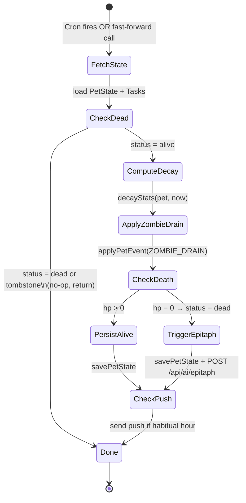

# Decay and Time Travel — Design

## Overview

Decay is a pure function of elapsed time. The Clock abstraction (`src/lib/game/clock.ts`) is the single seam between real wall time and game logic. In production, API route handlers read the real time once and pass it as `now: number` into pure functions. In tests and demo mode, an `OffsetClock` replaces the real clock transparently.

The `decayStats(pet, now)` function is the core: it reads `pet.lastTickAt`, computes elapsed hours, reduces stats proportionally, and clamps. Because the reduction is linear, the function is additive over intervals — the key invariant that makes catch-up and fast-forward correct.

The Vercel Cron job calls the same pure functions as the fast-forward demo route, ensuring the demo always exercises production code paths.

---

## Architecture

```mermaid
flowchart TD
    subgraph "src/lib/game/ (pure)"
        CL[clock.ts\nClock · OffsetClock]
        DC[decay.ts\ndecayStats · decayAmount]
        PE[pet.ts\napplyPetEvent DECAY_TICK branch]
        CO[constants.ts\nDECAY_RATE_* · STREAK_BREAK_HOURS]
    end

    subgraph "src/app/api/"
        CRON[cron/decay/route.ts\ndaily backstop cron]
        FF[demo/fast-forward/route.ts\ndemo-only fast-forward]
        PUSH[push/route.ts\npush subscription + send]
    end

    subgraph "src/lib/push/"
        VAPID[vapid.ts\nVAPID key helpers]
        NOTIFY[notify.ts\nsendPushNotification]
    end

    subgraph "src/components/ui/"
        DC_UI[DemoControls.tsx\nserver DEMO_MODE only]
    end

    CRON -->|decayStats(pet, now)| DC
    CRON -->|applyPetEvent(DECAY_TICK)| PE
    CRON -->|habitualHour check| PUSH
    FF -->|same decay path as CRON| DC
    FF -->|advance OffsetClock| CL
    DC_UI -->|POST /api/demo/fast-forward| FF
    PUSH --> VAPID
    PUSH --> NOTIFY
    CO --> DC
```

---

## Components and Interfaces

### `src/lib/game/clock.ts`

```ts
/** All game-logic timing goes through this interface. */
export interface Clock {
  now(): number; // Unix ms
}

/**
 * Deterministic clock for tests and demo fast-forward.
 * base: a fixed Unix ms start point supplied by the caller.
 * offsetMs: mutable advance; increased by advance().
 */
export class OffsetClock implements Clock {
  private offsetMs: number;

  constructor(private readonly base: number, initialOffset = 0) {
    this.offsetMs = initialOffset;
  }

  now(): number {
    return this.base + this.offsetMs;
  }

  advance(ms: number): void {
    if (ms < 0) throw new Error("OffsetClock cannot go backwards");
    this.offsetMs += ms;
  }

  reset(): void {
    this.offsetMs = 0;
  }

  get offset(): number {
    return this.offsetMs;
  }
}
```

`SystemClock` is **not** in this file. It lives in `src/lib/server/clock.ts` and is the only wall-clock call site. `src/lib/game/` must not call `Date.now()` or `new Date()` (enforced by ESLint `no-restricted-syntax` and the `no-date-now-guard` hook).

```ts
// src/lib/server/clock.ts
export class SystemClock implements Clock {
  now(): number {
    return Date.now();
  }
}

/** Effective game time. Fast-forward changes the offset, not lastTickAt. */
export function effectiveNow(systemNow: number, clockOffsetMs: number): number {
  return systemNow + clockOffsetMs;
}
```

### `src/lib/game/decay.ts`

```ts
import type { PetState } from "./pet";
import {
  DECAY_RATE_HP,
  DECAY_RATE_HUNGER,
  DECAY_RATE_MOOD,
  MAX_HP,
  STREAK_BREAK_HOURS,
  STREAK_BREAK_MOOD_PENALTY,
} from "./constants";

/**
 * Compute the HP reduction for a given number of elapsed hours.
 * Pure: same inputs → same output.
 */
export function decayAmount(ratePerHour: number, elapsedHours: number): number {
  return ratePerHour * elapsedHours;
}

/**
 * Apply time-based stat decay to a pet.
 * Uses `pet.lastTickAt` as the start of the decay interval.
 * Returns pet unchanged if dead, tombstone, or no elapsed time.
 *
 * @param pet   - current pet state
 * @param now   - current Unix ms (from injected clock, NOT Date.now())
 */
export function decayStats(pet: PetState, now: number): PetState {
  // Guard: dead/tombstone pets don't decay
  if (pet.status === "dead" || pet.status === "tombstone") return pet;

  const lastTick = pet.lastTickAt ?? now;
  const elapsedMs = now - lastTick;

  // Guard: time cannot go backwards; zero elapsed = no change
  if (elapsedMs <= 0) return pet;

  const elapsedHours = elapsedMs / 3_600_000;

  // Eggs are HP-immune; hunger and mood still decay
  const hpDecay = pet.stage === "egg" ? 0 : decayAmount(DECAY_RATE_HP, elapsedHours);
  const hungerDecay = decayAmount(DECAY_RATE_HUNGER, elapsedHours);
  const moodDecay = decayAmount(DECAY_RATE_MOOD, elapsedHours);

  const newHp = Math.max(0, Math.min(MAX_HP, pet.hp - hpDecay));
  const newHunger = Math.max(0, Math.min(100, pet.hunger - hungerDecay));
  let newMood = Math.max(0, Math.min(100, pet.mood - moodDecay));

  // Streak break check
  let newStreak = pet.currentStreak;
  const streakBreakMs = STREAK_BREAK_HOURS * 3_600_000;
  const streakBroken =
    pet.lastCompletionAt !== null &&
    newStreak > 0 &&
    now - pet.lastCompletionAt > streakBreakMs;

  if (streakBroken) {
    newStreak = 0;
    newMood = Math.max(0, newMood - STREAK_BREAK_MOOD_PENALTY);
  }

  // Do not flip status here. A dead pet short-circuits the next call, so a
  // split interval would drop hunger/mood that one combined call still applies.
  // applyPetEvent sets status to "dead" when the returned hp is 0.
  return {
    ...pet,
    hp: newHp,
    hunger: newHunger,
    mood: newMood,
    currentStreak: newStreak,
    lastTickAt: now,
  };
}

/**
 * Verify the additivity invariant in tests:
 * decayStats(decayStats(pet, t1), t2) ≡ decayStats(pet, t2)
 * (where pet.lastTickAt = t0 < t1 < t2)
 */
export function decayRange(pet: PetState, fromMs: number, toMs: number): PetState {
  const withLastTick: PetState = { ...pet, lastTickAt: fromMs };
  return decayStats(withLastTick, toMs);
}
```

### `src/app/api/cron/decay/route.ts` (signatures)

```ts
import { NextRequest, NextResponse } from "next/server";
import { SystemClock } from "@/lib/server/clock";
import { decayStats } from "@/lib/game/decay";
import { applyPetEvent } from "@/lib/game/pet";
import { activeZombies, makeZombieDrainEvent } from "@/lib/game/zombies";
import { isOverdue } from "@/lib/game/tasks";
// … db imports, push imports

export async function GET(request: NextRequest): Promise<NextResponse> {
  // 1. Verify CRON_SECRET
  // 2. For each user:
  //    a. getPetState + getTasks
  //    b. Identify newly overdue tasks (isOverdue), mark them
  //    c. newState = decayStats(petState, clock.now())
  //    d. zombieCount = activeZombies(tasks, now).length
  //    e. newState = applyPetEvent(newState, makeZombieDrainEvent(…), now)
  //    f. savePetState(newState)
  //    g. appendEvent for each change
  //    h. Send push notification if habitual hour matches
  // 3. Return 200 { processed: N }
}
```

### `src/app/api/demo/fast-forward/route.ts` (signatures)

```ts
import { z } from "zod";

const FastForwardBodySchema = z.union([
  z.object({ hours: z.union([z.literal(1), z.literal(6), z.literal(24)]) }),
  z.object({ reset: z.literal(true) }),
]);

export async function POST(request: Request): Promise<Response> {
  // 1. Require a signed-in user. 403 unless server env DEMO_MODE === "true"
  // 2. Parse body with FastForwardBodySchema → 400 if invalid
  // 3. If reset: set this user's clock_offset_ms to 0
  // 4. If hours N: add N hours to clock_offset_ms, then catch up once
  //    with effectiveNow (do not write lastTickAt past that time)
  // 5. Return updated pet state
}
```

### `src/lib/push/vapid.ts`

```ts
/** Returns VAPID keys from environment variables. Server-only. */
export function getVapidKeys(): { publicKey: string; privateKey: string } {
  const publicKey = process.env.NEXT_PUBLIC_VAPID_PUBLIC_KEY;
  const privateKey = process.env.VAPID_PRIVATE_KEY;
  if (!publicKey || !privateKey) {
    throw new Error("NEXT_PUBLIC_VAPID_PUBLIC_KEY and VAPID_PRIVATE_KEY must be set");
  }
  return { publicKey, privateKey };
}
```

### `src/lib/push/notify.ts`

```ts
import webpush from "web-push";
import { getVapidKeys } from "./vapid";

export interface PushPayload {
  title: string;
  body: string;
  tag?: string;
}

export async function sendPushNotification(
  subscription: webpush.PushSubscription,
  payload: PushPayload
): Promise<void> {
  const { publicKey, privateKey } = getVapidKeys();
  webpush.setVapidDetails(
    "mailto:ghost@haunted-pet-todo.app",
    publicKey,
    privateKey
  );
  await webpush.sendNotification(subscription, JSON.stringify(payload));
}
```

---

## Data Models

### Supabase Table: `push_subscriptions`

| Column | Type | Constraints | Notes |
|---|---|---|---|
| `id` | `uuid` | PK, default `gen_random_uuid()` | |
| `user_id` | `uuid` | NOT NULL, FK → `auth.users(id)` | RLS anchor |
| `endpoint` | `text` | NOT NULL, UNIQUE per user | Web Push endpoint URL |
| `p256dh` | `text` | NOT NULL | ECDH public key |
| `auth` | `text` | NOT NULL | Auth secret |
| `created_at` | `timestamptz` | NOT NULL, default `now()` | |

RLS: SELECT/INSERT/DELETE for `auth.uid() = user_id`. No UPDATE (delete + re-insert instead).

### Clock Offset Storage (server-side singleton for demo mode)

Per-user `pet_state.clock_offset_ms` (bigint, default 0). Every read/write and the daily cron use `effectiveNow = SystemClock.now() + clock_offset_ms`. Fast-forward updates that column (auth required, `DEMO_MODE=true`). It must not write `last_tick_at` ahead of the effective clock: `decayStats` treats `now < lastTickAt` as a no-op, so a future `lastTickAt` would stall catch-up. A module singleton does not survive serverless isolates.

---

## State Diagram: Decay Tick Processing



---

## Error Handling

| Scenario | Handling |
|---|---|
| `now < pet.lastTickAt` | `decayStats` returns `pet` unchanged (time-reversal guard) |
| `elapsedMs = 0` | `decayStats` returns `pet` unchanged (idempotent) |
| Cron missing `CRON_SECRET` | HTTP 401, no state changes |
| Fast-forward in production | HTTP 403, body not processed |
| Fast-forward with invalid `hours` | Zod validation → HTTP 400 |
| Push send failure | Log error, continue cron job, return 200 |
| `OffsetClock.advance(negative)` | Throws `Error("OffsetClock cannot go backwards")` — callers must guard |
| Stats float rounding | All values truncated via `Math.max(0, Math.floor(value))` before storage |

---

## Correctness Properties

**Property P18 — HP always in [0, MAX_HP] after any number of decay calls**
For any alive `PetState` with valid stats and any sequence of monotonically increasing `now` values, the result of chained `decayStats` calls always has `hp ∈ [0, MAX_HP]`.
- Generators: `arbAlivePetState`, `fc.array(fc.integer({ min: 0, max: 86_400_000 }))` (sorted increasing deltas)
- Validates: Requirements 3.2

**Property P19 — Decay additivity over split intervals**
For any alive `PetState p` with `lastTickAt = t0`, and any `t0 < t1 < t2`:
`decayStats(decayStats(p, t1), t2)` produces stats within ±1 of `decayStats({...p, lastTickAt: t0}, t2)`.
- Generators: `arbAlivePetState`, three ordered `fc.integer()` timestamps
- Validates: Requirement 4.1

**Property P20 — Fast-forward N hours equals N one-hour ticks**
For any `PetState p` and integer `N ∈ {1, 6, 24}`, applying decay + zombie drain N times with 1-hour increments produces the same `PetState` (within ±1 rounding) as applying it once with N hours.
- Generators: `arbAlivePetState`, `fc.constantFrom(1, 6, 24)`
- Validates: Requirements 7.4, 4.1

**Property P21 — Dead/tombstone pets are immune to decay**
For any `PetState` with `status = "dead" | "tombstone"`, `decayStats(pet, now).hp === pet.hp`.
- Generators: `arbDeadOrTombstoneState`, `fc.integer()`
- Validates: Requirement 3.4

**Property P22 — Egg HP is immune to decay**
For any `PetState` with `stage = "egg"`, `decayStats(pet, now).hp === pet.hp`.
- Generators: `arbEggState`, `fc.integer({ min: petState.lastTickAt + 1 })`
- Validates: Requirement 3.5

**Property P23 — Decay is monotone non-increasing**
For any alive `PetState p` and any `now > p.lastTickAt`, `decayStats(p, now).hp <= p.hp`.
- Generators: `arbAlivePetState`, `fc.integer()`
- Validates: Requirements 3.1, 3.2

**Property P24 — Time never moves backwards through OffsetClock**
For any `OffsetClock c` and sequence of non-negative advance amounts, `c.now()` is monotonically non-decreasing.
- Generators: `fc.integer({ min: 0 })` as base, `fc.array(fc.nat())` as advances
- Validates: Requirement 1.4

**Property P25 — Decay with zero elapsed time is identity**
`decayStats(pet, pet.lastTickAt)` returns a state where `hp`, `hunger`, `mood` are unchanged.
- Generators: `arbAlivePetState`
- Validates: Requirement 4.2

**Property P26 — Hunger and mood always in [0, 100] after decay**
For any alive `PetState` and any `now >= pet.lastTickAt`, `result.hunger ∈ [0, 100]` and `result.mood ∈ [0, 100]`.
- Generators: `arbAlivePetState`, `fc.integer()`
- Validates: Requirements 3.3

---

## Testing Strategy

### Unit Tests (`tests/game/decay.test.ts`)
- `decayStats` with dead pet returns unchanged state.
- `decayStats` with tombstone returns unchanged state.
- `decayStats` with egg returns unchanged HP but decays hunger/mood.
- `decayStats` with `now = lastTickAt` returns identical state.
- `decayStats` with `now < lastTickAt` returns identical state (reversal guard).
- `decayStats` after 1 hour reduces HP by `DECAY_RATE_HP`.
- `decayStats` after 1 hour reduces hunger by `DECAY_RATE_HUNGER`.
- `decayStats` clamps HP to 0 when decay exceeds remaining HP.
- Streak break sets streak to 0 and applies mood penalty when `lastCompletionAt` > 48h ago.
- `decayAmount(rate, hours)` is pure and returns `rate * hours`.

### Property-Based Tests (`tests/game/invariants.property.ts`)
See Properties P18–P26 above.

### Integration Tests
- Cron handler returns 401 for missing `CRON_SECRET`.
- Fast-forward handler returns 403 when server `DEMO_MODE !== "true"` or the caller is signed out.
- Fast-forward handler returns 400 for invalid `hours` value.
