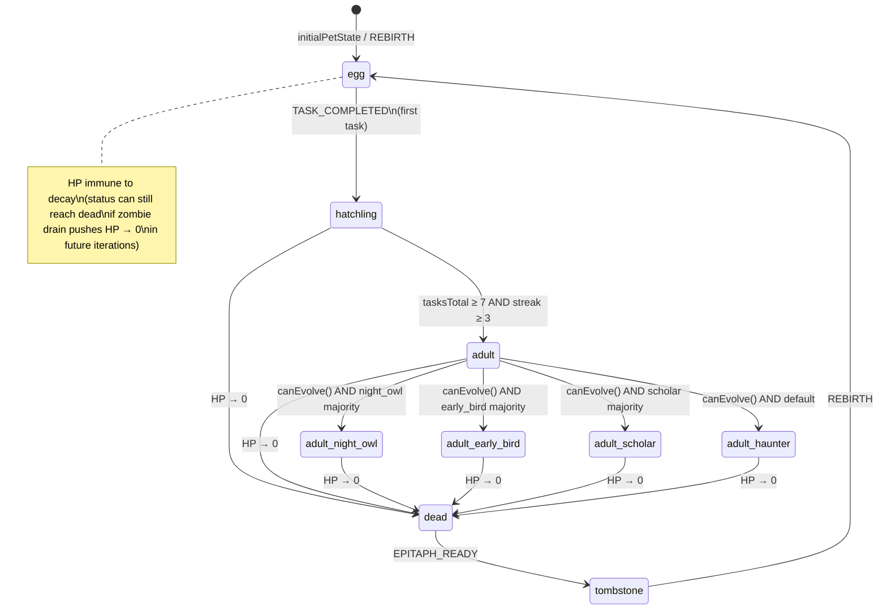

# Pet State Machine — Design

## Overview

The pet state machine is implemented entirely as pure functions in `src/lib/game/`. A central `applyPetEvent` reducer accepts a `PetState`, a `GameEvent`, and a `now: number` (Unix ms) and returns a new `PetState`. No mutation, no side effects, no I/O.

All life-stage transitions, stat clamping, streak logic, and evolution selection live here. The DB layer (`src/lib/db/pet.ts`) persists the state; React components read it via `GameStateProvider`; the cron job drives ticks via `applyPetEvent` with `DECAY_TICK` events.

---

## Architecture

```mermaid
flowchart TD
    subgraph "src/lib/game/ (pure)"
        PE[pet.ts\nPetState · initialPetState · rebirth]
        EV[events.ts\nGameEvent union]
        AP[pet.ts\napplyPetEvent]
        EVO[evolution.ts\ncanEvolve · resolveEvolvedForm]
        CO[constants.ts\nMAX_HP · DECAY_RATES · thresholds]
        CL[clock.ts\nClock · OffsetClock]
    end

    subgraph "src/lib/db/"
        DB[pet.ts\ngetPetState · savePetState]
    end

    subgraph "src/app/api/"
        CRON[cron/decay/route.ts]
        PET_API[pet/route.ts]
    end

    subgraph "src/components/"
        GS[providers/GameStateProvider.tsx]
        SP[pet/PetSprite.tsx]
        PS[pet/PetStats.tsx]
    end

    CRON -->|applyPetEvent(DECAY_TICK)| AP
    PET_API -->|applyPetEvent(TASK_COMPLETED / REBIRTH …)| AP
    AP --> DB
    DB -->|real-time subscription| GS
    GS --> SP
    GS --> PS
    AP --> EVO
    AP --> PE
    AP --> EV
    CO --> AP
    CL --> CRON
```

---

## Components and Interfaces

All types and functions below live in `src/lib/game/` unless otherwise noted.

### `src/lib/game/constants.ts`

```ts
export const MAX_HP = 100;
export const INITIAL_HUNGER = 100;
export const INITIAL_MOOD = 100;

// Decay per hour (applied by decayStats)
export const DECAY_RATE_HP = 5;       // HP lost per hour with no tasks done
export const DECAY_RATE_HUNGER = 8;   // Hunger lost per hour
export const DECAY_RATE_MOOD = 6;     // Mood lost per hour

// Zombie drain
export const ZOMBIE_DRAIN_PER_HOUR = 3; // HP drained per zombie per hour

// Evolution thresholds
export const EVOLVE_STREAK_THRESHOLD = 10;
export const EVOLVE_HOURS_AS_ADULT = 24;
export const ADULT_STREAK_THRESHOLD = 3;
export const ADULT_TASKS_THRESHOLD = 7;

// Streak break: hours without completion before streak resets
export const STREAK_BREAK_HOURS = 48;

// Task completion rewards
export const TASK_HUNGER_RESTORE = 20;
export const TASK_HP_RESTORE = 10;
export const TASK_MOOD_BOOST = 15;
export const OVERDUE_TASK_HUNGER_RESTORE = 10; // reduced for overdue
export const OVERDUE_TASK_HP_RESTORE = 5;

// Streak-break mood penalty
export const STREAK_BREAK_MOOD_PENALTY = 20;
```

### `src/lib/game/clock.ts`

> **Owned by decay-and-time-travel spec (task 1).** `src/lib/game/clock.ts` exports `Clock` and `OffsetClock` only. `SystemClock` lives in `src/lib/server/clock.ts` and is the one wall-clock call site, outside `src/lib/game/`. API routes read it once and pass `now: number` in.

### `src/lib/game/pet.ts`

```ts
import { MAX_HP, INITIAL_HUNGER, INITIAL_MOOD } from "./constants";
import type { GameEvent } from "./events";

export type PetStage =
  | "egg"
  | "hatchling"
  | "adult"
  | "adult_night_owl"
  | "adult_early_bird"
  | "adult_scholar"
  | "adult_haunter";

export type PetStatus = "alive" | "dead" | "tombstone";

export type EvolvedAdultStage =
  | "adult_night_owl"
  | "adult_early_bird"
  | "adult_scholar"
  | "adult_haunter";

export interface TombstoneRecord {
  readonly id: string;           // uuid
  readonly diedAt: number;       // Unix ms
  readonly stage: PetStage;
  readonly finalHp: number;
  readonly finalHunger: number;
  readonly finalMood: number;
  readonly tasksCompletedTotal: number;
  readonly epitaph: string;
  /** IDs of overdue tasks that contributed to the death */
  readonly overdueTaskIds: string[];
}

export interface PetState {
  readonly id: string;           // caller-supplied; stable across rebirths. Not generated inside the reducer.
  readonly userId: string;
  /** IANA zone for evolution hours and streak days. Not the server's zone. */
  readonly timeZone: string;
  readonly stage: PetStage;
  readonly status: PetStatus;
  readonly hp: number;           // [0, MAX_HP]
  readonly hunger: number;       // [0, 100]
  readonly mood: number;         // [0, 100]
  readonly currentStreak: number;
  readonly tasksCompletedTotal: number;
  /** Unix ms of last task completion; null if never completed. */
  readonly lastCompletionAt: number | null;
  /** Calendar day string "YYYY-MM-DD" of last completion. */
  readonly lastCompletionDay: string | null;
  /** Unix ms when the pet reached the 'adult' stage; null if not yet adult. */
  readonly becameAdultAt: number | null;
  /** Hours spent as adult (computed lazily in evolution check). */
  readonly hoursAsAdult: number;
  /** Timestamps of the last 10 task completions, newest first. */
  readonly recentCompletionTimestamps: number[];
  /** Categories of the last 10 completed tasks, parallel to recentCompletionTimestamps. */
  readonly recentCompletionCategories: string[];
  readonly currentEpitaph: string | null;
  /** Append-only history of dead pets. */
  readonly graveyard: readonly TombstoneRecord[];
  /** Unix ms of last processed tick, used for catch-up decay. */
  readonly lastTickAt: number | null;
}

/** Creates a fresh PetState for a brand-new user (no graveyard). */
export function initialPetState(userId: string, now: number, id: string, timeZone: string): PetState {
  return {
    id,
    userId,
    timeZone,
    stage: "egg",
    status: "alive",
    hp: MAX_HP,
    hunger: INITIAL_HUNGER,
    mood: INITIAL_MOOD,
    currentStreak: 0,
    tasksCompletedTotal: 0,
    lastCompletionAt: null,
    lastCompletionDay: null,
    becameAdultAt: null,
    hoursAsAdult: 0,
    recentCompletionTimestamps: [],
    recentCompletionCategories: [],
    currentEpitaph: null,
    graveyard: [],
    lastTickAt: now,
  };
}

/**
 * Rebirths a tombstone pet into a new egg,
 * preserving the graveyard.
 */
export function rebirthPet(state: PetState, now: number, tombstoneId: string): PetState {
  if (state.status !== "tombstone") return state;
  const record: TombstoneRecord = {
    id: tombstoneId,
    diedAt: state.lastTickAt ?? now,
    stage: state.stage,
    finalHp: state.hp,
    finalHunger: state.hunger,
    finalMood: state.mood,
    tasksCompletedTotal: state.tasksCompletedTotal,
    epitaph: state.currentEpitaph ?? "Here lies a to-do list. It never stood a chance.",
    overdueTaskIds: [],
  };
  return {
    ...initialPetState(state.userId, now, state.id, state.timeZone),
    graveyard: [...state.graveyard, record],
  };
}

/**
 * Central pure reducer. Applies a single GameEvent to PetState.
 * Never mutates input. Does not read the wall clock.
 * Returns `{ state, emitted }`. Early exits use `emitted: []`.
 * Consequence events (hatch, grow, evolve, death, streak break) are emitted here.
 */
export interface PetReduction {
  readonly state: PetState;
  readonly emitted: readonly GameEvent[];
}

export function applyPetEvent(
  state: PetState,
  event: GameEvent,
  now: number
): PetReduction {
  // Tombstone absorbs everything except REBIRTH and EPITAPH_READY
  if (
    state.status === "tombstone" &&
    event.type !== "REBIRTH" &&
    event.type !== "EPITAPH_READY"
  ) {
    return state;
  }

  // Dead pets absorb everything except EPITAPH_READY
  if (state.status === "dead" && event.type !== "EPITAPH_READY") {
    return state;
  }

  switch (event.type) {
    case "TASK_COMPLETED":
      return applyTaskCompleted(state, event, now);
    case "DECAY_TICK":
      return applyDecayTick(state, event, now);
    case "ZOMBIE_DRAIN":
      return applyZombieDrain(state, event, now);
    case "EPITAPH_READY":
      return applyEpitaphReady(state, event);
    case "REBIRTH":
      return rebirthPet(state, now);
    default:
      return state;
  }
}

// --- private helpers (exported for testing) ---

export function applyTaskCompleted(
  state: PetState,
  event: Extract<GameEvent, { type: "TASK_COMPLETED" }>,
  now: number
): PetState { /* ... see tasks.ts for full impl */ return state; }

export function applyDecayTick(
  state: PetState,
  event: Extract<GameEvent, { type: "DECAY_TICK" }>,
  now: number
): PetState { /* ... see decay.ts for full impl */ return state; }

export function applyZombieDrain(
  state: PetState,
  event: Extract<GameEvent, { type: "ZOMBIE_DRAIN" }>,
  now: number
): PetState { /* ... see zombies.ts for full impl */ return state; }

function applyEpitaphReady(
  state: PetState,
  event: Extract<GameEvent, { type: "EPITAPH_READY" }>
): PetState {
  if (state.status !== "dead") return state;
  return { ...state, status: "tombstone", currentEpitaph: event.epitaph };
}
```

### `src/lib/game/events.ts`

```ts
export type GameEvent =
  | { type: "TASK_COMPLETED"; taskId: string; wasOverdue: boolean; category: string; completedAt: number }
  | { type: "DECAY_TICK"; fromTime: number; toTime: number }
  | { type: "ZOMBIE_DRAIN"; zombieCount: number; fromTime: number; toTime: number }
  | { type: "EPITAPH_READY"; epitaph: string }
  | { type: "REBIRTH"; tombstoneId: string }
  | { type: "PET_HATCHED" }
  | { type: "PET_GREW_UP" }
  | { type: "PET_EVOLVED"; newStage: PetStage }
  | { type: "PET_DIED"; finalState: Omit<PetState, "graveyard"> }
  | { type: "STREAK_BROKEN" };
```

### `src/lib/game/evolution.ts`

```ts
import type { PetState, EvolvedAdultStage } from "./pet";
import { EVOLVE_STREAK_THRESHOLD, EVOLVE_HOURS_AS_ADULT } from "./constants";

/** Returns true if the pet currently meets all evolution preconditions. */
export function canEvolve(state: PetState, now: number): boolean {
  if (state.stage !== "adult" || state.status !== "alive") return false;
  if (state.currentStreak < EVOLVE_STREAK_THRESHOLD) return false;
  const hoursAsAdult =
    state.becameAdultAt !== null
      ? (now - state.becameAdultAt) / 3_600_000
      : 0;
  return hoursAsAdult >= EVOLVE_HOURS_AS_ADULT;
}

/**
 * Deterministically selects the evolved form from the recent completion history.
 * Priority: night_owl > early_bird > scholar > haunter.
 */
export function resolveEvolvedForm(state: PetState): EvolvedAdultStage {
  const timestamps = state.recentCompletionTimestamps;
  const categories = state.recentCompletionCategories;
  const n = Math.min(10, timestamps.length);

  let nightOwl = 0;
  let earlyBird = 0;
  let scholar = 0;

  if (n === 0) return "adult_haunter";

  for (let i = 0; i < n; i++) {
    const hourLocal = hourFromTimestamp(timestamps[i], state.timeZone);
    const cat = categories[i] ?? "";

    // 05:00–05:59 counts as night only, so night and early bird are disjoint.
    if (hourLocal >= 22 || hourLocal < 6) nightOwl++;
    else if (hourLocal >= 5 && hourLocal < 11) earlyBird++;
    if (cat === "study" || cat === "work") scholar++;
  }

  const majority = Math.floor(n / 2) + 1;
  if (nightOwl >= majority) return "adult_night_owl";
  if (earlyBird >= majority) return "adult_early_bird";
  if (scholar >= majority) return "adult_scholar";
  return "adult_haunter";
}

/** Local hour 0–23 in an IANA zone. Uses Intl, not the server's zone. */
export function hourFromTimestamp(ts: number, timeZone: string): number {
  const hour = new Intl.DateTimeFormat("en-US", {
    timeZone,
    hour: "numeric",
    hourCycle: "h23",
  }).formatToParts(ts).find((part) => part.type === "hour");
  const value = Number(hour?.value ?? "0");
  return value === 24 ? 0 : value;
}
```

---

## Data Models

### TypeScript Types

See `PetState`, `TombstoneRecord`, `PetStage`, `PetStatus` above.

### Supabase Table: `pet_state`

| Column | Type | Constraints | Notes |
|---|---|---|---|
| `id` | `uuid` | PK, default `gen_random_uuid()` | Stable across rebirths |
| `user_id` | `uuid` | NOT NULL, UNIQUE, FK → `auth.users(id)` | RLS anchor; one pet per user |
| `time_zone` | `text` | NOT NULL, default `'UTC'` | IANA zone for local hour and streak day |
| `clock_offset_ms` | `bigint` | NOT NULL, default `0`, `CHECK (>= 0)` | Demo offset added to wall time. Not a `PetState` field |
| `stage` | `text` | NOT NULL | One of the `PetStage` literals |
| `status` | `text` | NOT NULL, default `'alive'` | `alive` / `dead` / `tombstone` |
| `hp` | `integer` | NOT NULL, default 100, `CHECK (hp >= 0)` | |
| `hunger` | `integer` | NOT NULL, default 100, `CHECK (hunger BETWEEN 0 AND 100)` | |
| `mood` | `integer` | NOT NULL, default 100, `CHECK (mood BETWEEN 0 AND 100)` | |
| `current_streak` | `integer` | NOT NULL, default 0 | |
| `tasks_completed_total` | `integer` | NOT NULL, default 0 | |
| `last_completion_at` | `timestamptz` | nullable | |
| `last_completion_day` | `date` | nullable | `YYYY-MM-DD` |
| `became_adult_at` | `timestamptz` | nullable | |
| `hours_as_adult` | `numeric` | NOT NULL, default 0 | |
| `recent_completion_timestamps` | `bigint[]` | NOT NULL, default `'{}'` | Unix ms, newest first |
| `recent_completion_categories` | `text[]` | NOT NULL, default `'{}'` | Parallel to above |
| `current_epitaph` | `text` | nullable | |
| `graveyard` | `jsonb` | NOT NULL, default `'[]'` | Array of `TombstoneRecord` |
| `last_tick_at` | `timestamptz` | nullable | |
| `created_at` | `timestamptz` | NOT NULL, default `now()` | |
| `updated_at` | `timestamptz` | NOT NULL, default `now()` | |

RLS policies (migration `0002_rls.sql`):
```sql
ALTER TABLE pet_state ENABLE ROW LEVEL SECURITY;
CREATE POLICY "users manage own pet" ON pet_state
  USING (auth.uid() = user_id)
  WITH CHECK (auth.uid() = user_id);
```

---

## State Diagram



---

## Error Handling

| Scenario | Handling |
|---|---|
| `applyPetEvent` receives unknown event type | Returns `state` unchanged (exhaustive default branch) |
| Stats underflow | Clamped to 0 via `Math.max(0, value)` |
| Stats overflow | Clamped to MAX_HP / 100 via `Math.min(MAX, value)` |
| `rebirthPet` called on non-tombstone state | Guard: returns `state` unchanged |
| `PATCH /api/pet` body is not `REBIRTH` or a time-zone update | HTTP 400. `TASK_COMPLETED`, `DECAY_TICK`, `ZOMBIE_DRAIN`, and other game events are server-produced only |
| `resolveEvolvedForm` called with empty history | Returns `"adult_haunter"` (default) |
| `crypto.randomUUID` unavailable | Caller must ensure Node ≥ 19 / Web Crypto available |

---

## Correctness Properties

These are the invariants verified by fast-check property-based tests in `tests/game/invariants.property.ts`.

**Property P1 — HP bounds**
For any `PetState s` with valid stats and any sequence of `GameEvent[]`, after applying all events via `applyPetEvent`, `result.hp` is in `[0, MAX_HP]`.
- Generators: `fc.record({ hp: fc.integer({min:0, max:MAX_HP}), … })`, `fc.array(arbGameEvent)`
- Validates: Requirements 8.1, 8.2

**Property P2 — Hunger bounds**
For any `PetState` and any sequence of events, `result.hunger` is always in `[0, 100]`.
- Generators: same as P1
- Validates: Requirement 9.1

**Property P3 — Mood bounds**
For any `PetState` and any sequence of events, `result.mood` is always in `[0, 100]`.
- Generators: same as P1
- Validates: Requirement 10.1

**Property P4 — Dead/tombstone absorbs damage**
For any `PetState` with `status = "dead" | "tombstone"` and any `DECAY_TICK` or `ZOMBIE_DRAIN` event, `result.hp === state.hp` (no change).
- Generators: `arbDeadOrTombstoneState`, `arbDamageEvent`
- Validates: Requirements 5.2, 5.3, 6.3

**Property P5 — Task completion never lowers HP**
For any alive `PetState` and a `TASK_COMPLETED` event, `result.hp >= state.hp`.
- Generators: `arbAlivePetState`, `arbTaskCompletedEvent`
- Validates: Requirement 8.1 (task completion direction)

**Property P6 — Evolution is deterministic**
For any `PetState s` with stage `"adult"` and streak ≥ 10, calling `resolveEvolvedForm(s)` twice returns the same `EvolvedAdultStage`.
- Generators: `arbAdultReadyForEvolution`
- Validates: Requirement 4.2–4.7

**Property P7 — Rebirth produces full HP egg**
For any tombstone `PetState`, `rebirthPet(state, now).hp === MAX_HP` and `.stage === "egg"` and `.status === "alive"`.
- Generators: `arbTombstoneState`, `fc.integer()`
- Validates: Requirements 7.1, 7.2

**Property P8 — Graveyard is append-only**
For any `PetState` with graveyard length N and a `REBIRTH` event, the resulting graveyard has length N+1 and the first N entries are unchanged.
- Generators: `arbTombstoneState`
- Validates: Requirement 7.3

**Property P9 — applyPetEvent is pure (same inputs → same output)**
For any `state`, `event`, `now`, calling `applyPetEvent` twice with identical arguments returns equal results.
- Generators: `arbPetState`, `arbGameEvent`, `fc.integer()`
- Validates: Requirement 13.2

**Property P10 — Stat clamp is idempotent**
Applying `clampStats` to an already-clamped `PetState` returns an equal state.
- Generators: `arbPetState`
- Validates: Requirements 8.1, 9.1, 10.1

---

## Testing Strategy

### Unit Tests (`tests/game/pet.test.ts`)
- `initialPetState` produces an egg with MAX_HP.
- `applyPetEvent` with `TASK_COMPLETED` on egg triggers hatchling.
- `applyPetEvent` with `TASK_COMPLETED` beyond thresholds triggers adult.
- `applyPetEvent` with `DECAY_TICK` driving HP to 0 sets status `"dead"`.
- `applyPetEvent` with `EPITAPH_READY` on dead sets status `"tombstone"`.
- `applyPetEvent` with `REBIRTH` on tombstone produces egg + graveyard entry.
- Dead pet ignores `DECAY_TICK`.
- Unknown event type returns unchanged state.

### Unit Tests (`tests/game/evolution.test.ts`)
- `canEvolve` returns false for hatchling.
- `canEvolve` returns false when streak < 10.
- `canEvolve` returns false when hoursAsAdult < 24.
- `resolveEvolvedForm` returns `"adult_night_owl"` for majority night completions.
- `resolveEvolvedForm` returns `"adult_early_bird"` for morning majority.
- `resolveEvolvedForm` returns `"adult_scholar"` for study/work majority.
- `resolveEvolvedForm` returns `"adult_haunter"` for mixed/empty history.
- Priority order: night_owl takes precedence over early_bird.

### Property-Based Tests (`tests/game/invariants.property.ts`)
See Properties P1–P10 above.
