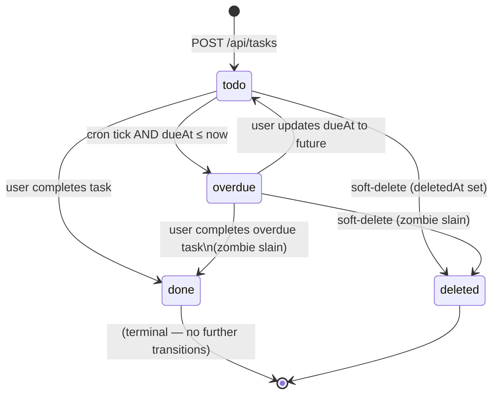

# Task Lifecycle — Design

## Overview

The task lifecycle spans three layers: pure game logic in `src/lib/game/tasks.ts` and `src/lib/game/zombies.ts`, database persistence in `src/lib/db/tasks.ts`, and API surface in `src/app/api/tasks/route.ts`. The UI only talks to the API routes; it never imports DB or LLM clients.

Completing a task triggers a cascade: the API marks the task `done`, calls `applyPetEvent(TASK_COMPLETED)` on the pet state, slays any zombie, and appends an event log entry — all in a single server-side atomic unit.

---

## Architecture

```mermaid
flowchart TD
    subgraph "Browser"
        TL[TaskList.tsx]
        TF[TaskForm.tsx]
        ZL[ZombieLayer.tsx]
        GS[GameStateProvider.tsx]
    end

    subgraph "src/app/api/"
        TR[tasks/route.ts\nCRUD + overdue check]
        BD[ai/breakdown/route.ts\nLLM subtask breakdown]
        CRON[cron/decay/route.ts\ndaily backstop + catch-up]
    end

    subgraph "src/lib/game/ (pure)"
        TG[tasks.ts\nisOverdue · completeTask · spawnZombie check]
        ZG[zombies.ts\nspawnZombies · zombieDrain · slayZombie]
        AP[pet.ts\napplyPetEvent]
        EV[events.ts\nGameEvent]
    end

    subgraph "src/lib/db/"
        DT[tasks.ts\ngetTasks · upsertTask · deleteTask]
        DE[events.ts\nappendEvent]
        DP[pet.ts\ngetPetState · savePetState]
    end

    subgraph "src/lib/ai/"
        AI[breakdown.ts\nbuildBreakdownPrompt]
        SC[schemas.ts\nBreakdownResponseSchema]
    end

    TF -->|POST /api/tasks| TR
    TL -->|PATCH /api/tasks/[id]| TR
    TL -->|POST /api/ai/breakdown| BD
    TR --> DT
    TR --> TG
    TR --> AP
    TR --> DE
    TR --> DP
    CRON --> TG
    CRON --> ZG
    CRON --> AP
    BD --> AI
    BD --> SC
    GS -->|fetch /api/tasks| TR
    GS -->|real-time subscription| DP
    GS --> ZL
```

---

## Components and Interfaces

### `src/lib/game/tasks.ts`

```ts
import type { PetState } from "./pet";
import type { GameEvent } from "./events";
import {
  TASK_HUNGER_RESTORE,
  TASK_HP_RESTORE,
  TASK_MOOD_BOOST,
  OVERDUE_TASK_HUNGER_RESTORE,
  OVERDUE_TASK_HP_RESTORE,
} from "./constants";

export type TaskStatus = "todo" | "done" | "overdue";

export type TaskCategory =
  | "study"
  | "work"
  | "chores"
  | "health"
  | "creative"
  | "other";

export type TaskSize = "small" | "medium" | "large";

export interface Task {
  readonly id: string;
  readonly userId: string;
  readonly title: string;
  readonly notes: string | null;
  readonly category: TaskCategory;
  readonly size: TaskSize;
  readonly status: TaskStatus;
  readonly dueAt: number | null;       // Unix ms
  readonly completedAt: number | null; // Unix ms
  readonly deletedAt: number | null;   // Unix ms; null = not deleted
  readonly parentId: string | null;    // non-null for subtasks
  readonly breakdownSuggested: boolean;
  readonly allSubtasksDone: boolean;
  readonly sortOrder: number;
  readonly createdAt: number;          // Unix ms
}

/**
 * Returns true if a task is past its due date and not yet done.
 * Pure: never reads the clock directly.
 */
export function isOverdue(task: Task, now: number): boolean {
  return (
    task.status !== "done" &&
    task.dueAt !== null &&
    task.dueAt <= now &&
    task.deletedAt === null
  );
}

/**
 * Returns the stat deltas for completing a task.
 * Does not mutate — caller applies these via applyPetEvent.
 */
export function taskCompletionDeltas(task: Task): {
  hungerRestore: number;
  hpRestore: number;
  moodBoost: number;
} {
  if (task.status === "overdue") {
    return {
      hungerRestore: OVERDUE_TASK_HUNGER_RESTORE,
      hpRestore: OVERDUE_TASK_HP_RESTORE,
      moodBoost: TASK_MOOD_BOOST,
    };
  }
  return {
    hungerRestore: TASK_HUNGER_RESTORE,
    hpRestore: TASK_HP_RESTORE,
    moodBoost: TASK_MOOD_BOOST,
  };
}

/**
 * Produces the GameEvent for completing a task.
 * Pure: caller passes `now`.
 */
export function makeTaskCompletedEvent(
  task: Task,
  now: number
): Extract<GameEvent, { type: "TASK_COMPLETED" }> {
  return {
    type: "TASK_COMPLETED",
    taskId: task.id,
    wasOverdue: task.status === "overdue",
    category: task.category,
    completedAt: now,
  };
}
```

### `src/lib/game/zombies.ts`

```ts
import { ZOMBIE_DRAIN_PER_HOUR } from "./constants";
import type { Task } from "./tasks";
import type { GameEvent } from "./events";

export interface ZombieState {
  /** Same as the overdue task's id */
  readonly taskId: string;
  /** Unix ms when the zombie was spawned */
  readonly spawnedAt: number;
  /** Whether this zombie has been slain (task completed / deleted) */
  readonly slain: boolean;
}

/**
 * Given a list of tasks and the current time,
 * returns the set of tasks that should have active zombies.
 * Pure: same inputs → same outputs.
 */
export function activeZombies(tasks: readonly Task[], now: number): ZombieState[] {
  return tasks
    .filter((t) => t.status === "overdue" && t.deletedAt === null)
    .map((t) => ({
      taskId: t.id,
      spawnedAt: t.dueAt ?? now,
      slain: false,
    }));
}

/**
 * Produces a ZOMBIE_DRAIN GameEvent for a given tick interval.
 * zombieCount is the number of active (un-slain) zombies.
 */
export function makeZombieDrainEvent(
  zombieCount: number,
  fromTime: number,
  toTime: number
): Extract<GameEvent, { type: "ZOMBIE_DRAIN" }> {
  return {
    type: "ZOMBIE_DRAIN",
    zombieCount,
    fromTime,
    toTime,
  };
}

/**
 * Total HP damage for N zombies over a period expressed in hours.
 */
export function zombieDamage(zombieCount: number, hours: number): number {
  return zombieCount * ZOMBIE_DRAIN_PER_HOUR * hours;
}
```

### `src/lib/ai/breakdown.ts`

```ts
import type { Task } from "../game/tasks";

/**
 * Builds the prompt string for the LLM task breakdown call.
 * Pure: no I/O. Caller sends it to the API.
 */
export function buildBreakdownPrompt(task: Task): string {
  return [
    `You are a helpful ghost assistant. Break this task into 3–7 concrete subtasks.`,
    `Each subtask must be a single short sentence (< 80 chars) starting with a verb.`,
    `Task title: "${task.title}"`,
    task.notes ? `Additional notes: "${task.notes}"` : "",
    `Category: ${task.category}`,
    `Return JSON: { "intro": "<ghost-voice opener, ≤ 140 chars>", "subtasks": ["...", ...] }`,
  ]
    .filter(Boolean)
    .join("\n");
}
```

### `src/lib/ai/schemas.ts` (relevant section)

```ts
import { z } from "zod";

export const BreakdownResponseSchema = z.object({
  intro: z.string().max(140),
  subtasks: z.array(z.string().max(80)).min(3).max(7),
});

export type BreakdownResponse = z.infer<typeof BreakdownResponseSchema>;
```

### `src/app/api/tasks/route.ts` (signatures)

```ts
// GET /api/tasks — returns Task[] for authenticated user
export async function GET(request: Request): Promise<Response>;

// POST /api/tasks — creates a new task
export async function POST(request: Request): Promise<Response>;

// PATCH /api/tasks/[id] — updates a task (complete, reorder, edit fields)
// DELETE /api/tasks/[id] — soft-deletes a task
```

---

## Data Models

### TypeScript Types

See `Task`, `TaskStatus`, `TaskCategory`, `TaskSize`, `ZombieState` above.

### Supabase Table: `tasks`

| Column | Type | Constraints | Notes |
|---|---|---|---|
| `id` | `uuid` | PK, default `gen_random_uuid()` | |
| `user_id` | `uuid` | NOT NULL, FK → `auth.users(id)` | RLS anchor |
| `title` | `text` | NOT NULL, `CHECK (length(title) > 0)` | |
| `notes` | `text` | nullable | |
| `category` | `text` | NOT NULL, default `'other'` | Check constraint: allowed values |
| `size` | `text` | NOT NULL, default `'medium'` | `small`, `medium`, `large` |
| `status` | `text` | NOT NULL, default `'todo'` | `todo`, `done`, `overdue` |
| `due_at` | `timestamptz` | nullable | |
| `completed_at` | `timestamptz` | nullable | |
| `deleted_at` | `timestamptz` | nullable | soft delete |
| `parent_id` | `uuid` | nullable, FK → `tasks(id)` | subtask pointer |
| `breakdown_suggested` | `boolean` | NOT NULL, default `false` | |
| `all_subtasks_done` | `boolean` | NOT NULL, default `false` | |
| `sort_order` | `integer` | NOT NULL, default 0 | |
| `created_at` | `timestamptz` | NOT NULL, default `now()` | |
| `updated_at` | `timestamptz` | NOT NULL, default `now()` | |

### Supabase Table: `events`

| Column | Type | Constraints | Notes |
|---|---|---|---|
| `id` | `uuid` | PK, default `gen_random_uuid()` | |
| `user_id` | `uuid` | NOT NULL, FK → `auth.users(id)` | RLS anchor |
| `event_type` | `text` | NOT NULL | e.g. `TASK_COMPLETED`, `ZOMBIE_SLAIN` |
| `payload` | `jsonb` | NOT NULL, default `'{}'` | Event-specific data |
| `created_at` | `timestamptz` | NOT NULL, default `now()` | |

RLS: INSERT only for `auth.uid() = user_id`; no DELETE.

---

## State Diagram: Task Status Transitions



---

## Error Handling

| Scenario | Handling |
|---|---|
| Missing/empty `title` on create | Zod validation → HTTP 400 with field error |
| Invalid `category` value | Zod enum check → HTTP 400 |
| Complete already-done task | HTTP 409 Conflict |
| LLM breakdown fails | Return fallback subtasks; set `intro` to default ghost message |
| LLM returns > 7 subtasks | Truncate to 7 after Zod parse |
| `parentId` points to non-existent task | HTTP 404 |
| Zombie drain on dead pet | Guard in `applyPetEvent` — returns state unchanged |
| Concurrent completion race | Supabase atomic update: `UPDATE tasks SET status='done' WHERE id=$1 AND status != 'done'` — returns 0 rows if already done → 409 |

---

## Correctness Properties

**Property P11 — Each overdue task has exactly one active zombie**
For any list of `Task[]` where some are `overdue`, `activeZombies(tasks, now)` returns exactly one `ZombieState` per overdue task and zero for non-overdue tasks.
- Generators: `fc.array(arbTask)`, `fc.integer()` for `now`
- Validates: Requirements 5.3, 5.4

**Property P12 — Done tasks have no active zombie**
For any `Task` with `status = "done"`, `activeZombies([task], now).length === 0`.
- Generators: `arbDoneTask`, `fc.integer()`
- Validates: Requirement 5.3

**Property P13 — Task completion never lowers pet HP**
For any alive `PetState p` and any `TASK_COMPLETED` event, `applyPetEvent(p, event, now).state.hp >= p.hp`.
- Generators: `arbAlivePetState`, `arbTaskCompletedEvent`
- Validates: Requirements 7.2, 8.2

**Property P14 — Completing a done task is a no-op**
For any `PetState p` and a `TASK_COMPLETED` event for a task already marked done, `applyPetEvent` called a second time with the same event returns a state where `hp`, `hunger`, `mood` are unchanged.
- Generators: `arbAlivePetState`, `arbTaskCompletedEvent`
- Validates: Requirement 9.2

**Property P15 — zombieDamage scales linearly**
For any non-negative `zombieCount` and `hours`, `zombieDamage(zombieCount, hours) === zombieCount * ZOMBIE_DRAIN_PER_HOUR * hours`.
- Generators: `fc.nat()`, `fc.float({min: 0, max: 100})`
- Validates: Requirement 6.1

**Property P16 — isOverdue is consistent with status**
For any `Task` with `status = "done"`, `isOverdue(task, now) === false` regardless of `dueAt`.
- Generators: `arbDoneTask`, `fc.integer()`
- Validates: Requirement 5.1

**Property P17 — Subtask breakdown returns 3–7 items**
For any `BreakdownResponse` validated by `BreakdownResponseSchema`, `subtasks.length` is in `[3, 7]`.
- Generators: arbitrary JSON parsed through schema
- Validates: Requirement 11.2

---

## Testing Strategy

### Unit Tests (`tests/game/tasks.test.ts`)
- `isOverdue` returns false for done task regardless of dueAt.
- `isOverdue` returns false for task with no dueAt.
- `isOverdue` returns false for task with future dueAt.
- `isOverdue` returns true for task with past dueAt and status `todo`.
- `taskCompletionDeltas` returns reduced values for overdue task.
- `makeTaskCompletedEvent` sets `wasOverdue = true` for overdue task.

### Unit Tests (`tests/game/zombies.test.ts`)
- `activeZombies` returns one zombie per overdue task.
- `activeZombies` returns empty for all-done task list.
- `activeZombies` excludes soft-deleted tasks.
- `zombieDamage` returns 0 for 0 zombies.
- `zombieDamage(2, 1) === 2 * ZOMBIE_DRAIN_PER_HOUR`.

### Unit Tests (`tests/ai/breakdown.test.ts`)
- `buildBreakdownPrompt` includes task title in output.
- `buildBreakdownPrompt` omits notes section when notes is null.
- `BreakdownResponseSchema` rejects payloads with < 3 or > 7 subtasks.
- `BreakdownResponseSchema` rejects payloads with subtasks > 80 chars.

### Property-Based Tests (`tests/game/invariants.property.ts`)
See Properties P11–P17 above.

### Integration Tests (`tests/db/tasks.test.ts`)
- `getTasks` filters deleted tasks by default.
- `upsertTask` updates `updated_at` on every save.
- `appendEvent` inserts with correct `event_type` and `user_id`.
